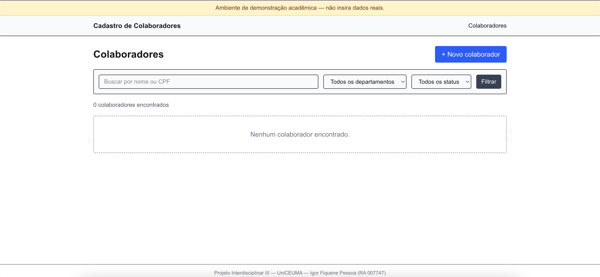
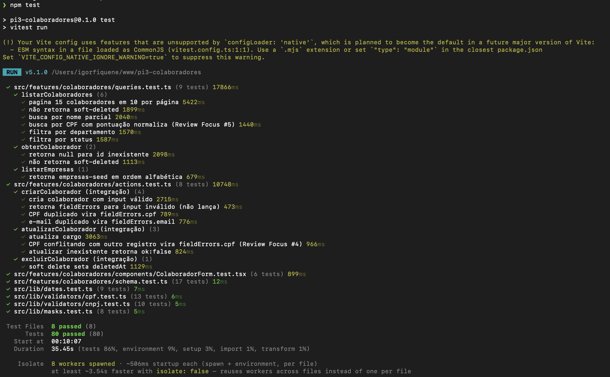
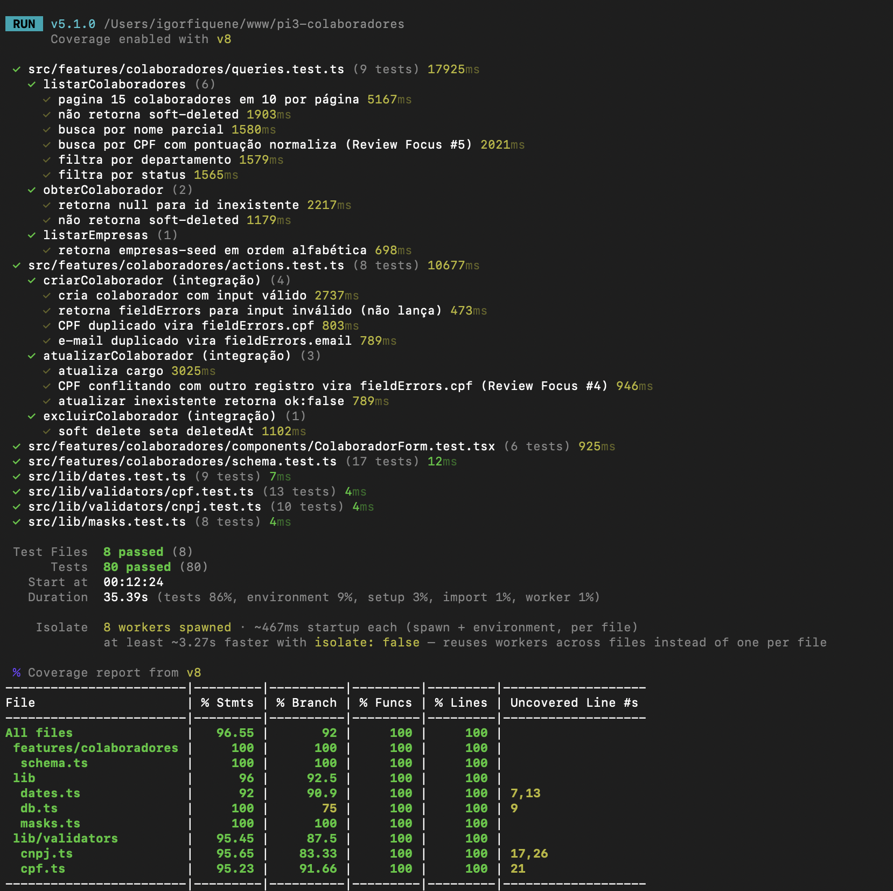
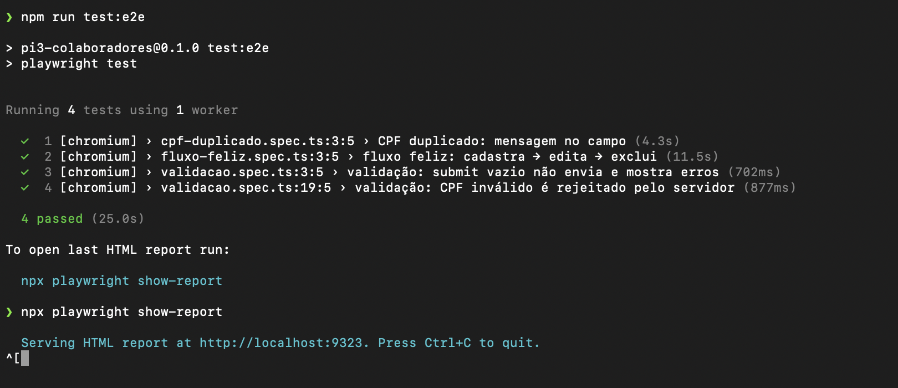
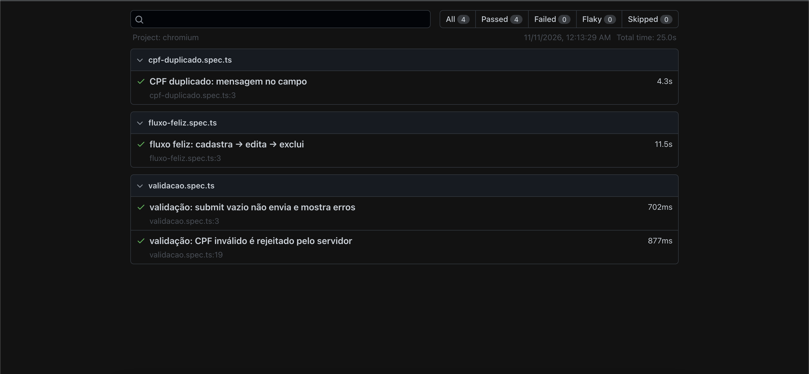
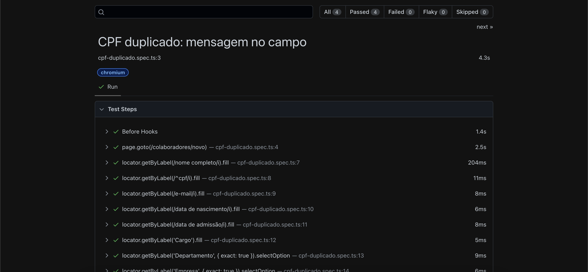
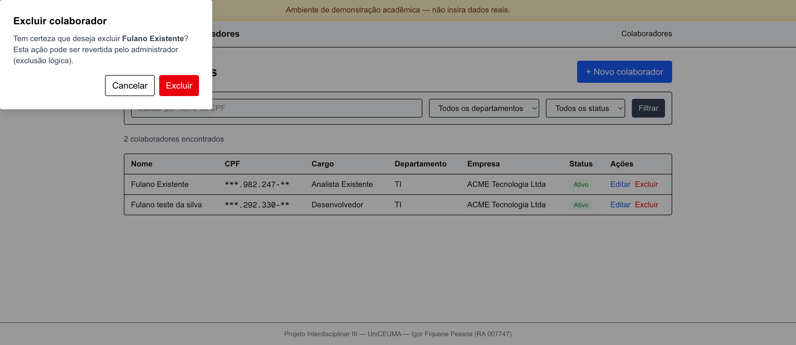
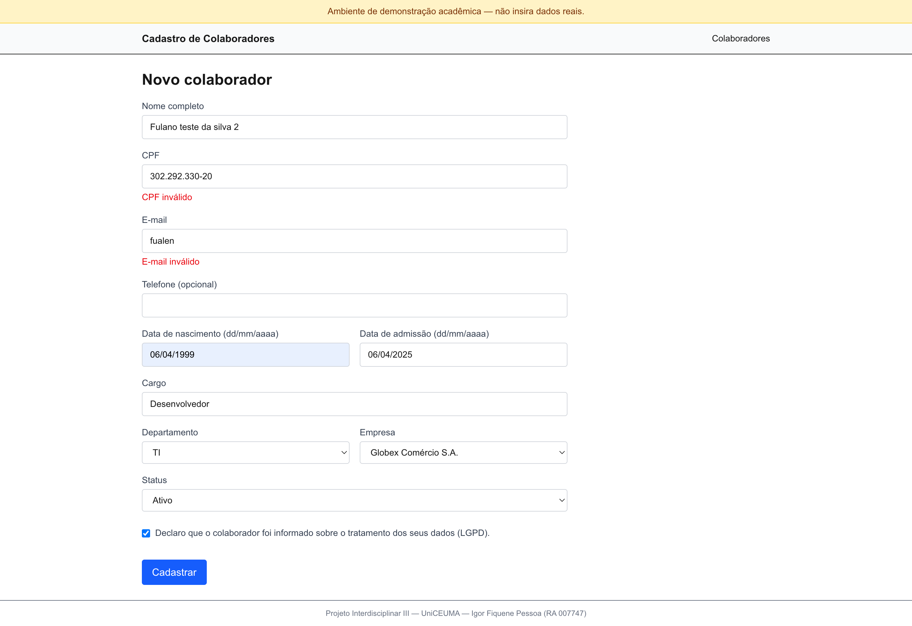
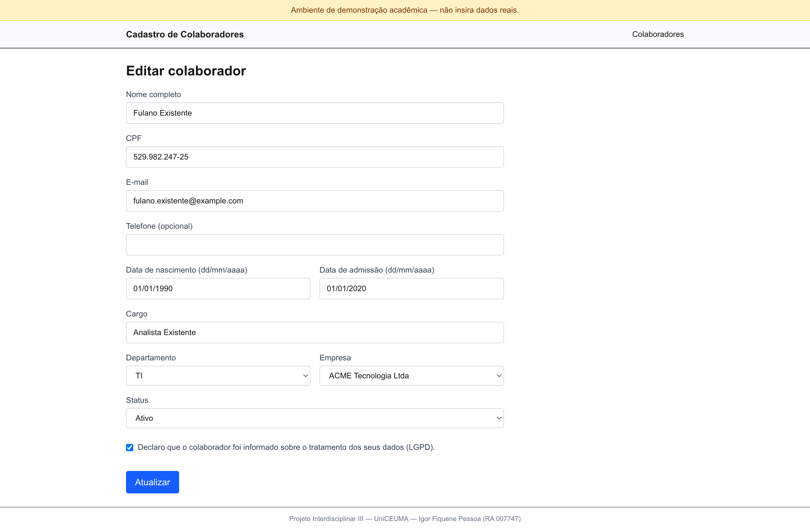
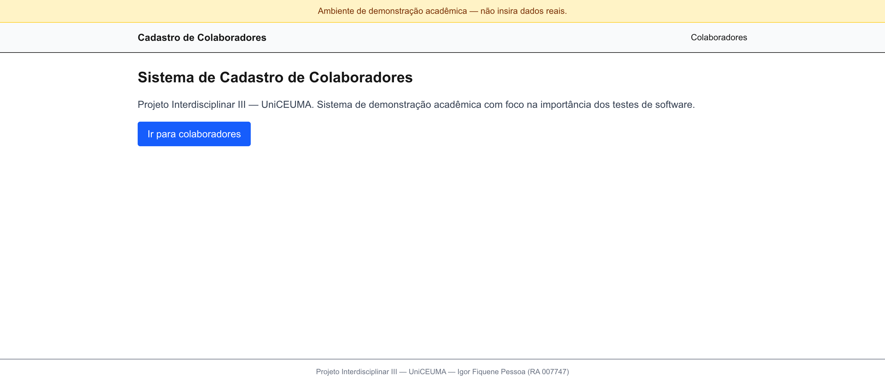

# Prints de Evidência — PI III

Capturas de tela usadas no relatório acadêmico. Datas no formato dd/mm/aaaa.

Para versionar, salve cada imagem em `docs/evidencias/prints/` com o **nome de arquivo sugerido** abaixo.

---

## Print 01 — Aplicação publicada

**Arquivo:** `prints/01-site-publicado-colaboradores.png`
**Captura:** 11/11/2026
**O que mostra:** página `/colaboradores` da aplicação em produção no domínio `pi3-colaboradores.vercel.app`, acessada por um navegador externo.

**Elementos visíveis que comprovam escopo entregue:**
- Banner fixo amarelo no topo: _"Ambiente de demonstração acadêmica — não insira dados reais"_ (requisito LGPD).
- Cabeçalho "Cadastro de Colaboradores" + navegação "Colaboradores".
- Título da seção "Colaboradores" + botão **"+ Novo colaborador"**.
- Barra de filtro com campo de busca "Buscar por nome ou CPF", select "Todos os departamentos", select "Todos os status" e botão "Filtrar".
- Estado vazio tratado: _"Nenhum colaborador encontrado"_ (contagem "0 colaboradores encontrados" acima).
- Rodapé: _"Projeto Interdisciplinar III — UniCEUMA — Igor Fiquene Pessoa (RA 007747)"_.

**O que o print prova pro relatório:**
- Sistema está publicado em domínio público (requisito do PI III: "implantado").
- Identidade da entrega acadêmica aparece no rodapé.
- Preocupação explícita com LGPD no banner.

**Onde usar no relatório:** Seção **Resultados** / **Implantação**.

---

## Print 02 — Suíte de testes verde (`npm test`)

**Arquivo:** `prints/02-npm-test-80-passed.png`
**Captura:** 11/11/2026 às 00:10
**O que mostra:** execução de `npm test` no terminal, com breakdown por arquivo de teste.

**Elementos visíveis:**
- `queries.test.ts` — 9 testes (pagina 15 colaboradores em 10 por página; busca por nome parcial; busca por CPF com pontuação normaliza (Review Focus #5); filtra por departamento; filtra por status; obterColaborador (2 casos); listarEmpresas).
- `actions.test.ts` — 8 testes (criarColaborador 4 casos; atualizarColaborador 3 casos; excluirColaborador — soft delete).
- `ColaboradorForm.test.tsx` — 6 testes.
- `schema.test.ts` — 17 testes.
- `dates.test.ts` — 9 testes.
- `cpf.test.ts` — 13 testes.
- `cnpj.test.ts` — 10 testes.
- `masks.test.ts` — 8 testes.
- **Totais:** `8 passed (8)` arquivos e `80 passed (80)` testes em `35,45 s`.

**O que o print prova pro relatório:**
- A suíte de testes é real e executável.
- Cobertura por tipo (unitários, integração, componente) está materializada em arquivos.
- Tempo total razoável (~35 s) pra rodar em CI ou localmente.

**Onde usar no relatório:**
- Evidência direta da hipótese 1 do PI II (testes unitários encontram erros).
- Evidência da hipótese 4 (suíte robusta).
- Seção **Metodologia** / **Resultados**.

---

## Print 03 — Suíte + cobertura (`npm run test:coverage`)

**Arquivo:** `prints/03-coverage-report.png`
**Captura:** 11/11/2026 às 00:12
**O que mostra:** `npm run test:coverage` com relatório V8 por arquivo.

**Elementos visíveis — tabela de cobertura:**

| Arquivo | % Stmts | % Branch | % Funcs | % Lines |
|---|---|---|---|---|
| All files | 96,55 | 92 | 100 | 100 |
| features/colaboradores/schema.ts | 100 | 100 | 100 | 100 |
| lib | 96 | 92,5 | 100 | 100 |
| lib/dates.ts | 92 | 90,9 | 100 | 100 |
| lib/db.ts | 100 | 75 | 100 | 100 |
| lib/masks.ts | 100 | 100 | 100 | 100 |
| lib/validators/cnpj.ts | 95,65 | 83,33 | 100 | 100 |
| lib/validators/cpf.ts | 95,23 | 91,66 | 100 | 100 |

Total ao pé: `Test Files 8 passed (8)`, `Tests 80 passed (80)`, `Duration 35,39 s`.

**O que o print prova pro relatório:**
- Cobertura real acima da meta de 80% em toda a lógica pura (`src/lib/`) e no schema Zod.
- 100% de funções cobertas — sanidade estrutural.
- Linhas não cobertas identificadas pontualmente (ex.: `cpf.ts:21`) são branches de erro raras.

**Onde usar no relatório:**
- Evidência quantitativa da hipótese 2 (código testável é código modular).
- Seção **Resultados** / tabela anexa.

---

## Print 04 — Testes E2E Playwright verdes (`npm run test:e2e`)

**Arquivo:** `prints/04-playwright-test-e2e-4-passed.png`
**Captura:** 11/11/2026 às 00:13
**O que mostra:** terminal com saída de `npm run test:e2e`.

**Elementos visíveis — 4 cenários passando:**
1. `cpf-duplicado.spec.ts:3:5 › CPF duplicado: mensagem no campo` — 4,3 s
2. `fluxo-feliz.spec.ts:3:5 › fluxo feliz: cadastra → edita → exclui` — 11,5 s
3. `validacao.spec.ts:3:5 › validação: submit vazio não envia e mostra erros` — 702 ms
4. `validacao.spec.ts:19:5 › validação: CPF inválido é rejeitado pelo servidor` — 877 ms

`4 passed (25,0 s)`.

**O que o print prova pro relatório:**
- Testes de sistema (E2E, via navegador real) rodam e passam contra o build de produção local.
- Os três cenários cobrem o fluxo completo exigido pelo escopo: criar → listar → editar → excluir, validação de formulário, e unicidade de CPF.

**Onde usar no relatório:**
- Evidência direta da hipótese 3 (testes de integração/sistema confirmam que form, validação e banco funcionam juntos).
- Seção **Testes de Sistema**.

---

## Print 05 — Relatório HTML do Playwright (resumo)

**Arquivo:** `prints/05-playwright-report-resumo.png`
**Captura:** 11/11/2026 às 00:14
**O que mostra:** interface HTML do `npx playwright show-report`, visão de resumo.

**Elementos visíveis:**
- Filtros no topo: `All 4`, `Passed 4`, `Failed 0`, `Flaky 0`, `Skipped 0`.
- Project: `chromium`. Timestamp: `11/11/2026, 12:13:29 AM`. Total time: `25.0 s`.
- Lista expandida por arquivo (`cpf-duplicado.spec.ts`, `fluxo-feliz.spec.ts`, `validacao.spec.ts`) com durações de cada teste.

**O que o print prova pro relatório:**
- Relatório formal gerado por ferramenta de teste de sistema padrão da indústria.
- Zero falhas, zero testes flaky, zero skipped — qualidade executável.

**Onde usar no relatório:**
- Figura em anexo evidenciando o uso profissional do Playwright.
- Seção **Testes de Sistema**.

---

## Print 06 — Playwright detalhado: passos do teste "CPF duplicado"

**Arquivo:** `prints/06-playwright-report-detalhe-cpf-duplicado.png`
**Captura:** 11/11/2026 às 00:15
**O que mostra:** detalhe do teste `CPF duplicado: mensagem no campo` no relatório HTML.

**Elementos visíveis — passos registrados:**
- `Before Hooks` — 1,4 s
- `page.goto(/colaboradores/novo)` — 2,5 s
- `locator.getByLabel(/nome completo/i).fill` — 204 ms
- `locator.getByLabel(/^cpf/i).fill` — 11 ms
- `locator.getByLabel(/e-mail/i).fill` — 8 ms
- `locator.getByLabel(/data de nascimento/i).fill` — 6 ms
- `locator.getByLabel(/data de admissão/i).fill` — 8 ms
- `locator.getByLabel('Cargo').fill` — 5 ms
- `locator.getByLabel('Departamento', { exact: true }).selectOption` — 9 ms
- `locator.getByLabel('Empresa', { exact: true }).selectOption` — 6 ms

**O que o print prova pro relatório:**
- Cada ação do usuário simulado é registrada por Playwright com timestamp e status individual.
- Esse nível de granularidade é o que permite depurar falhas de sistema.
- Prova que o teste **simula o usuário real** navegando, preenchendo e submetendo o formulário.

**Onde usar no relatório:**
- Figura em anexo, imediatamente após o Print 05.
- Seção **Testes de Sistema** / **Metodologia**.

---

---

## Print 07 — Listagem com CPF mascarado + modal de exclusão

**Arquivo:** `prints/07-listagem-cpf-mascarado-e-modal-exclusao.png`
**Captura:** 11/11/2026 às 00:43
**O que mostra:** página `/colaboradores` em produção, com dois colaboradores reais cadastrados, modal de confirmação de exclusão aberto para "Fulano Existente".

**Elementos visíveis — duas evidências em uma imagem:**

*Evidência LGPD (mascaramento de CPF):*
- Tabela com colunas Nome, CPF, Cargo, Departamento, Empresa, Status, Ações.
- Linha 1: Fulano Existente — CPF exibido como `***.982.247-**` — Analista Existente — TI — ACME Tecnologia Ltda — Ativo.
- Linha 2: Fulano teste da silva — CPF exibido como `***.292.330-**` — Desenvolvedor — TI — ACME Tecnologia Ltda — Ativo.
- Contagem: "2 colaboradores encontrados".

*Evidência do modal nativo (não `window.confirm`):*
- Modal sobreposto à esquerda com título **"Excluir colaborador"**.
- Texto: _"Tem certeza que deseja excluir **Fulano Existente**? Esta ação pode ser revertida pelo administrador (exclusão lógica)."_
- Botões: "Cancelar" (branco) e "Excluir" (vermelho).
- Overlay semi-transparente escurecendo o fundo.

**O que o print prova pro relatório:**
- A mascaramento de CPF (LGPD) está efetivamente aplicada na UI em produção.
- O sistema explica o modelo de exclusão lógica ao usuário antes de confirmar.
- O modal não é `window.confirm` nativo (visual customizado) — atende o requisito do design.

**Onde usar no relatório:** Seção **8.4 Privacidade e LGPD** e seção **8.3 Funcionalidades** (modal de confirmação).

---

## Print 08 — Formulário de cadastro com erros de validação visíveis

**Arquivo:** `prints/08-form-cadastro-com-erros-validacao.png`
**Captura:** 11/11/2026 às 00:43
**O que mostra:** tela `/colaboradores/novo` com o formulário preenchido com dados inválidos propositalmente, erros exibidos pelo sistema.

**Elementos visíveis:**
- Campo "Nome completo": `Fulano teste da silva 2`.
- Campo "CPF": `302.292.330-20` com máscara aplicada corretamente.
- **Erro em vermelho abaixo do campo CPF:** _"CPF inválido"_ (dígitos verificadores errados).
- Campo "E-mail": `fualen` (string sem `@`).
- **Erro em vermelho abaixo do campo E-mail:** _"E-mail inválido"_.
- Datas preenchidas: `06/04/1999` (nascimento) e `06/04/2025` (admissão).
- Departamento "TI", Empresa "Globex Comércio S.A.", Status "Ativo".
- Checkbox LGPD marcado.
- Botão "Cadastrar" habilitado.

**O que o print prova pro relatório:**
- Validação de CPF por dígitos verificadores funciona em produção, não só nos testes unitários.
- Validação de e-mail pelo schema Zod funciona em produção.
- Mensagens de erro aparecem **abaixo do campo correto**, em vermelho — padrão de acessibilidade com `aria-describedby`.
- Máscara de CPF foi aplicada enquanto o usuário digitava (`302.292.330-20`).

**Onde usar no relatório:**
- Figura acompanhando a seção **4.1 Identificação e Correção de Erros Precocemente**.
- Figura acompanhando a seção **8.3 Funcionalidades** (regras de validação).

---

## Print 09 — Formulário de edição com dados pré-preenchidos

**Arquivo:** `prints/09-form-edicao-prepreenchido.png`
**Captura:** 11/11/2026 às 00:43
**O que mostra:** tela `/colaboradores/[id]/editar` para o registro "Fulano Existente" aberto para edição.

**Elementos visíveis:**
- Título: "Editar colaborador".
- Todos os campos pré-populados com dados do banco:
  - Nome: `Fulano Existente`
  - CPF: `529.982.247-25` (**sem mascaramento aqui — propósito legítimo de edição**)
  - E-mail: `fulano.existente@example.com`
  - Data de nascimento: `01/01/1990`
  - Data de admissão: `01/01/2020`
  - Cargo: `Analista Existente`
  - Departamento: `TI`
  - Empresa: `ACME Tecnologia Ltda`
  - Status: `Ativo`
  - Consentimento LGPD: marcado
- Botão de ação: **"Atualizar"** (ao invés de "Cadastrar").

**O que o print prova pro relatório:**
- A tela de edição executa `obterColaborador` (query do banco real), preenchendo o form corretamente.
- O CPF aparece **completo** aqui, confirmando o princípio da LGPD de "finalidade": é mostrado só quando há propósito legítimo (editar aquele colaborador específico).
- O form é o mesmo componente `ColaboradorForm` usado no cadastro — reaproveitamento comprovado.

**Onde usar no relatório:** Seção **8.3 Funcionalidades** (cadastro, listagem, edição, exclusão).

---

## Print 10 — Home page do sistema

**Arquivo:** `prints/10-home-page-publica.png`
**Captura:** 11/11/2026 às 00:44
**O que mostra:** página raiz `/` da aplicação em produção.

**Elementos visíveis:**
- Banner amarelo no topo: _"Ambiente de demonstração acadêmica — não insira dados reais"_.
- Cabeçalho "Cadastro de Colaboradores" com link "Colaboradores".
- Título principal: **"Sistema de Cadastro de Colaboradores"**.
- Texto explicativo: _"Projeto Interdisciplinar III — UniCEUMA. Sistema de demonstração acadêmica com foco na importância dos testes de software."_
- Botão CTA azul: "Ir para colaboradores".
- Rodapé com identificação do autor.

**O que o print prova pro relatório:**
- A página inicial comunica claramente o propósito acadêmico do projeto.
- A identidade do autor aparece em todas as páginas (rodapé).
- Banner de ambiente de demonstração presente em toda a navegação.

**Onde usar no relatório:** Opcional. Pode substituir o Print 01 como "foto de apresentação" na introdução, ou entrar como figura inicial da seção **11. Implantação e teste beta**.

---

## Mapeamento Prints ↔ Hipóteses do PI II

| Hipótese | Prints que a sustentam |
|---|---|
| H1 — Testes unitários identificam erros cedo | 02 (80 passed), 03 (cobertura) |
| H2 — Código testável = design modular/coeso | 03 (cobertura 100% em `schema.ts`, `masks.ts`, `db.ts`; lógica pura em `src/lib`) |
| H3 — Integração garante componentes juntos | 02 (`actions.test.ts`, `queries.test.ts` com banco real), 04-05-06 (E2E cobre form→action→banco) |
| H4 — Suíte robusta = continuidade/sem regressão | 02 (80/80), 03 (threshold 80% atingido), 04 (4/4 E2E) |
| **Implantação (requisito do PI III)** | 01, 10 (app no ar em domínio público) |
| **UI em funcionamento (demo)** | 07, 08, 09 |
| **LGPD aplicada (CPF mascarado na lista)** | 07 |
| **Modal nativo (não `window.confirm`)** | 07 (modal de exclusão aberto) |
| **Validações do schema Zod em produção** | 08 (CPF inválido e e-mail inválido rejeitados pela UI) |

---

## Estado atual e pendências

### ✅ Prints capturadas (10 de 10 essenciais + bônus)

- [x] 01 — Site publicado
- [x] 02 — `npm test` 80 passed
- [x] 03 — Cobertura 96,55%
- [x] 04 — `npm run test:e2e` 4 passed
- [x] 05 — Playwright HTML report (resumo)
- [x] 06 — Playwright HTML report (detalhe)
- [x] 07 — Listagem com CPF mascarado + modal exclusão
- [x] 08 — Form de cadastro com erros de validação
- [x] 09 — Form de edição pré-preenchido
- [x] 10 — Home page pública

### 📋 Opcionais (só se o professor pedir mais evidência)

- [ ] 11 — Vercel dashboard mostrando deploy `READY`
- [ ] 12 — `git log --oneline` no terminal mostrando commits em português
- [ ] 13 — Página do GitHub (visão do repo público)
- [ ] 14 — Prisma Studio ou `psql` mostrando as tabelas com dados
- [ ] 15 — Terminal com `npm run build` concluído (evidência do pipeline Prisma + Next)

### ❌ Não mandar

- Prints da IDE com código — o código está no GitHub, não precisa duplicar
- Qualquer coisa com `.env` ou connection string (segurança)
- Prints com dados pessoais reais do beta
- Diagramas que não correspondam ao que foi efetivamente construído
